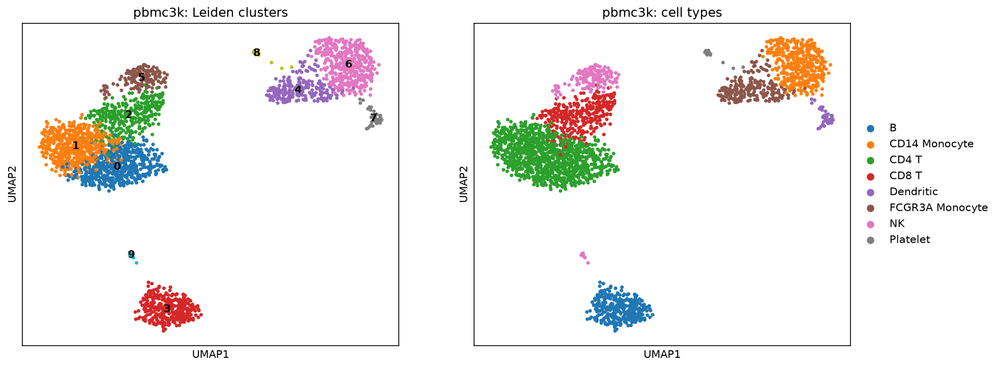

# Snakemake workflow: scRNA-seq analysis of PBMCs

Exercise 2 (scRNA-seq Analysis Pipeline), Computer and Software Architectures, FHNW.
Authors: Jaime López Balandín, Ronaldo Alvarez Flores

A Snakemake workflow that downloads 10x Genomics count matrices, filters and normalises them,
clusters the cells, annotates cell types from marker genes and draws a UMAP, for any number of samples.



## Datasets

Two samples of peripheral blood mononuclear cells (PBMCs) from healthy donors, from 10x Genomics:

| Sample | Cells | Genes | MD5 of `matrix.mtx` |
|---|---|---|---|
| `pbmc3k` | 2,700 | 32,738 | `e8e3b07963c966a1ac150de3d17dabae` |
| `pbmc6k` | 5,419 | 32,738 | `6444847dd29d127598a6ea67fd320e35` |

Each sample is a filtered count matrix (`matrix.mtx`, `genes.tsv`, `barcodes.tsv`).
The download URLs are in `config/config.yaml`; the workflow downloads the data itself,
so no data files need to be supplied.

## Workflow


`dag.png` shows every job (one branch per sample); `rulegraph.png` shows one box per rule.

| Rule | Type | What it does | Output |
|---|---|---|---|
| `get_data` | shell | Downloads the 10x matrix with `wget` and unpacks it with `tar` | `data/{sample}/` |
| `summary` | shell | Counts cells and genes, computes an MD5 checksum (`wc`, `md5sum`) | `results/{sample}/summary.txt` |
| `preprocess` | Python | Reads the matrix; filters cells (`min_genes`), genes (`min_cells`) and dying cells (`max_pct_mt`); normalises to 10,000 counts per cell and log-transforms | `preprocessed.h5ad` |
| `cluster` | Python | Highly variable genes, PCA, neighbour graph, Leiden clustering, UMAP; annotates each cluster with the cell type whose marker score is highest | `clustered.h5ad` |
| `plot` | Python | UMAP coloured by cluster and by cell type; dotplot of marker genes | `umap.png`, `markers.png` |
| `test` | shell | Step 1 of the exercise: writes `test.txt` | `test.txt` |

### Snakemake concepts used

- **Wildcards:** every rule uses `{sample}`, and `rule all` uses `expand()` over the samples in the config. Adding a sample is one line under `samples:`.
- **Config file:** `config/config.yaml` holds the sample URLs, filtering and clustering parameters, threads, memory and the marker genes.
- **No absolute paths:** all paths are relative to the project folder, and the data is downloaded from a URL, so the workflow runs on any machine.
- **Shell commands and scripts:** `get_data` and `summary` are shell rules; `preprocess`, `cluster` and `plot` run Python scripts through `script:`.
- **Conda environment:** `envs/scanpy.yaml` (Python 3.12, Scanpy, igraph, leidenalg, matplotlib), built automatically with `--use-conda`.
- **Threads and resources:** `cluster` uses `threads:` (passed to Scanpy). `preprocess` and `cluster` request memory with `mem_mb=lambda wc, attempt: attempt * config["mem_mb"]` and have `retries: 3`, so a job that fails (e.g. out of memory) is retried with 2×, then 3×, then 4× the memory.
- **Logs and benchmarks:** each rule writes to `logs/`; `preprocess` and `cluster` record runtime and memory in `benchmarks/`.
- **DAG:** `dag.png` and `rulegraph.png`.

## How to run

Requires conda (e.g. Miniforge) on Linux or WSL, and an internet connection for the download.

```bash
# 1. Environment with Snakemake and Graphviz (once)
mamba create -n snakemake -c conda-forge -c bioconda snakemake graphviz
conda activate snakemake

# 2. Dry run, then run
snakemake -n
snakemake --cores 4 --use-conda

# 3. Draw the DAG and the rule graph
snakemake --dag | dot -Tpng > dag.png
snakemake --rulegraph | dot -Tpng > rulegraph.png

# Optional: override a parameter without editing the config
snakemake --cores 4 --use-conda --config resolution=0.5
```

## Results

| Sample | Cells after filtering | Genes after filtering | Leiden clusters | Cell types found |
|---|---|---|---|---|
| `pbmc3k` | 2,643 | 13,714 | 10 | 8 |
| `pbmc6k` | 5,293 | 14,343 | 12 | 8 |

Both samples contain the 8 expected PBMC cell types: CD4 T, CD8 T, NK, B, CD14 monocytes,
FCGR3A monocytes, dendritic cells and platelets. The same workflow and parameters work on both
samples without any change. `results/{sample}/markers.png` shows the marker genes behind each label.


### Parameter choices

Both were changed in the config only, without touching the code:

- **Resolution 0.5 → 1.0.** At 0.5 the CD8 T cells were merged with the NK cells and the FCGR3A monocytes with the CD14 monocytes.
- **More specific markers.** NKG7 is expressed by both NK and cytotoxic CD8 T cells, so CD8 T cells were labelled NK. NK is now defined by GNLY, KLRF1 and KLRD1, and CD8 T by CD8A and CD8B.

The annotation is automatic and approximate: very small clusters (e.g. a handful of isolated cells)
still get the best-scoring label, which may not be meaningful.

## Folder contents

```
Snakefile
config/config.yaml
envs/scanpy.yaml
scripts/preprocess.py, cluster.py, plot.py
results/{pbmc3k,pbmc6k}/umap.png, markers.png, summary.txt
logs/, benchmarks/
dag.png, rulegraph.png
test.txt
```

The downloaded data (`data/`) and the intermediate `.h5ad` files are not included because of their size;
running the workflow recreates them.
