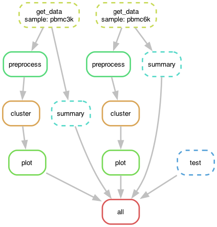
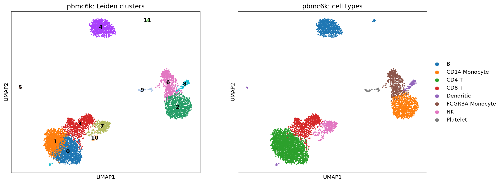

# Snakemake workflow: scRNA-seq analysis of PBMCs

Exercise 2 (scRNA-seq Analysis Pipeline), Computer and Software Architectures, FHNW.
Authors: Jaime López Balandín, Ronaldo Alvarez Flores

A reproducible Snakemake workflow that downloads 10x Genomics count matrices, performs quality control and normalization, clusters cells, annotates cell types from marker genes and generates UMAP and marker visualizations for any number of samples.


## Project objective

Build a reproducible Snakemake workflow for PBMC
single-cell RNA-seq analysis.

The workflow automatically performs:

1. Data download
2. Quality control
3. Filtering
4. Normalization
5. Highly variable gene selection
6. PCA
7. Leiden clustering
8. Cell-type annotation
9. UMAP visualization
10. Marker visualization

## Datasets

Two samples of peripheral blood mononuclear cells (PBMCs) from healthy donors, from 10x Genomics:

| Sample | Cells | Genes | MD5 of `matrix.mtx` |
|---|---|---|---|
| `pbmc3k` | 2,700 | 32,738 | `e8e3b07963c966a1ac150de3d17dabae` |
| `pbmc6k` | 5,419 | 32,738 | `6444847dd29d127598a6ea67fd320e35` |

Each sample is a filtered count matrix (`matrix.mtx`, `genes.tsv`, `barcodes.tsv`).
The download URLs are in `config/config.yaml`; the workflow downloads the data itself,
so no data files need to be supplied.

## Workflow



`dag.png` shows every job (one branch per sample); `rulegraph.png` shows one box per rule.

| Rule | Type | What it does | Output |
|---|---|---|---|
| `get_data` | shell | Downloads the 10x matrix with `wget` and unpacks it with `tar` | `data/{sample}/` |
| `summary` | shell | Counts cells and genes, computes an MD5 checksum (`wc`, `md5sum`) | `results/{sample}/summary.txt` |
| `preprocess` | Python | Reads the matrix; filters cells (`min_genes`), genes (`min_cells`) and dying cells (`max_pct_mt`); normalises to 10,000 counts per cell and log-transforms | `preprocessed.h5ad` |
| `cluster` | Python | Highly variable genes, PCA, neighbour graph, Leiden clustering, UMAP; annotates each cluster with the cell type whose marker score is highest | `clustered.h5ad` |
| `plot` | Python | UMAP coloured by cluster and by cell type; dotplot of marker genes | `umap.png`, `markers.png` |
| `test` | shell | Step 1 of the exercise: writes `test.txt` | `test.txt` |

### Snakemake concepts used

- **Wildcards:** every rule uses `{sample}`, and `rule all` uses `expand()` over the samples in the config. Adding a sample is one line under `samples:`.
- **Config file:** `config/config.yaml` holds the sample URLs, filtering and clustering parameters, threads, memory and the marker genes.
- **No absolute paths:** all paths are relative to the project folder, and the data is downloaded from a URL, so the workflow runs on any machine.
- **Shell commands and scripts:** `get_data` and `summary` are shell rules; `preprocess`, `cluster` and `plot` run Python scripts through `script:`.
- **Conda environment:** `envs/scanpy.yaml` (Python 3.12, Scanpy, igraph, leidenalg, matplotlib), built automatically with `--use-conda`.
- **Threads and resources:** `cluster` uses `threads:` and `preprocess`/`cluster` request memory with `mem_mb=lambda wc, attempt: attempt * config["mem_mb"]`. They also use `retries: 3`, so failed jobs can be retried with progressively larger memory allocations.
- **Logs and benchmarks:** the analysis rules write execution logs, while `preprocess` and `cluster` also record runtime and resource usage in `benchmarks/`. These generated files are excluded from GitHub by `.gitignore`.
- **DAG:** `dag.png` and `rulegraph.png`.

## How to run

Requires Conda/Mamba (e.g. Miniforge) and an internet connection for the data download. The workflow uses relative paths and creates its Scanpy environment automatically with Snakemake.

```bash
# 1. Environment with Snakemake and Graphviz (once)
mamba create -n snakemake -c conda-forge -c bioconda snakemake graphviz
conda activate snakemake

# 2. Dry run, then run
snakemake -n
snakemake --cores 4 --use-conda

# 3. Draw the DAG and the rule graph
snakemake --dag | dot -Tpng > dag.png
snakemake --rulegraph | dot -Tpng > rulegraph.png

# Optional: override a parameter without editing the config
snakemake --cores 4 --use-conda --config resolution=0.5
```

## Reproducibility

The repository contains the workflow definition, configuration, scripts, Conda environment,
DAG/rule graph and final figures. Raw downloaded data and intermediate `.h5ad` files are
not committed to GitHub because of their size; they are recreated automatically by the workflow.

The analysis is parameterised through `config/config.yaml`, so changing filtering thresholds,
clustering resolution or marker genes does not require modifying the Python scripts.

## Results

| Sample | Cells after filtering | Genes after filtering | Leiden clusters | Cell types found |
|---|---|---|---|---|
| `pbmc3k` | 2,643 | 13,714 | 10 | 8 |
| `pbmc6k` | 5,293 | 14,343 | 12 | 8 |

Both samples contain the 8 expected PBMC cell types: CD4 T, CD8 T, NK, B, CD14 monocytes,
FCGR3A monocytes, dendritic cells and platelets. The same workflow and parameters work on both
samples without any change. `results/{sample}/markers.png` shows the marker genes behind each label.



### Parameter choices

Both were changed in the config only, without touching the code:

- **Resolution 0.5 → 1.0.** At 0.5 the CD8 T cells were merged with the NK cells and the FCGR3A monocytes with the CD14 monocytes.
- **More specific markers.** NKG7 is expressed by both NK and cytotoxic CD8 T cells, so CD8 T cells were labelled NK. NK is now defined by GNLY, KLRF1 and KLRD1, and CD8 T by CD8A and CD8B.

The annotation is automatic and approximate: very small clusters (e.g. a handful of isolated cells)
still get the best-scoring label, which may not be meaningful.

## Folder contents

```text
Snakefile
config/config.yaml
envs/scanpy.yaml
scripts/preprocess.py
scripts/cluster.py
scripts/plot.py
results/{pbmc3k,pbmc6k}/umap.png
results/{pbmc3k,pbmc6k}/markers.png
results/{pbmc3k,pbmc6k}/summary.txt
dag.png
rulegraph.png
test.txt
```

Generated logs and benchmarks are kept locally during execution but excluded from GitHub.
The downloaded data (`data/`) and intermediate `.h5ad` files are also excluded because of their size;
running the workflow recreates them.


## Conclusion

This project demonstrates a complete reproducible scRNA-seq workflow rather than a collection
of independent scripts: Snakemake manages dependencies, parameters, environments and resources,
while Scanpy performs the single-cell analysis.
